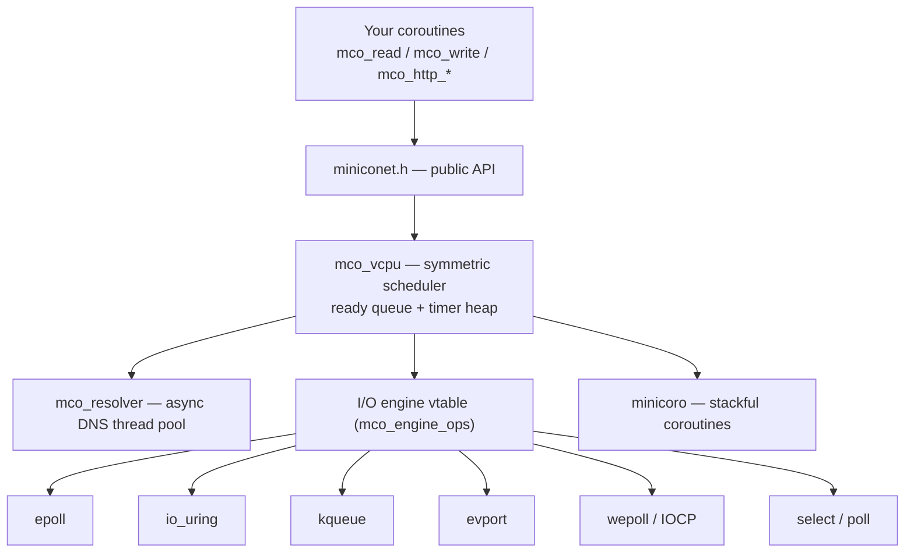

<div align="center">

# miniconet

**A coroutine-based, cross-platform network library in pure C89.**

Stackful coroutines ([minicoro](https://github.com/edubart/minicoro)) + a hand-written I/O engine
with 8 backends. Write blocking-looking network code; the runtime turns it into an event loop.

[](https://github.com/firear/miniconet/actions/workflows/ci.yml)
[](#platform-support)
[](#platform-support)
[](LICENSE)
[](#contributing)

[English](README.md) · [简体中文](README.zh-CN.md)

</div>

---

## Why miniconet

- **No callbacks, no state machines.** One coroutine per connection. `mco_read()` suspends *the
  coroutine*, never the thread — so your code reads top-to-bottom like a blocking program.
- **One API for TCP / UDP / TLS / Unix sockets.** The same `mco_read` / `mco_write` work whether the
  socket is plaintext or TLS; the library does the handshake behind `mco_wait_io`.
- **Async DNS that never stalls the scheduler.** Name resolution runs on a background pool and the
  coroutine parks on a pipe — the event loop keeps serving other connections.
- **Lower CPU per request, lower tail latency.** 24–26% less server CPU on HTTP than a mature C++
  runtime, at 1.3–1.4× the throughput. See [Performance](#performance).
- **Minimal by default.** Optional modules (HTTP, WebSocket, MQTT, KCP, UPnP, protocol clients…) are
  compiled only when you turn them on.
- **Portable.** Pure C89 (gnu89 extensions for POSIX headers). 8 I/O backends, selected per platform
  at build time, with a runtime fallback.

```c
/* A whole echo server: accept a connection, copy bytes until EOF. */
static void echo_conn(void* arg) {
    mco_socket_t* conn = (mco_socket_t*)arg;
    char buf[1024];
    int n;
    while ((n = mco_read(conn, buf, sizeof(buf), -1)) > 0)
        if (mco_write_all(conn, buf, n, -1) != n) break;
    mco_close(conn);
    mco_socket_destroy(conn);
}
```

## Features

| Area | What you get |
|---|---|
| Coroutines | `mco_loop_new` / `mco_spawn` / `mco_loop_run`, per-loop stack pooling, `mco_sleep` |
| TCP | listen / accept / connect / read / write / shutdown / close; non-blocking connect with failure classification (`MCO_CONNECT_REFUSED` / `DNS` / `TIMEOUT` …) |
| UDP | `mco_udp_bind`, lazy dual-stack `mco_udp_socket`, `sendto` / `recvfrom` |
| TLS | OpenSSL, mbedTLS, GnuTLS, Windows Schannel, Apple TLS — pick one at build time |
| Unix sockets | `mco_tcp_listen_unix` / `mco_tcp_connect_unix` (opt-in) |
| Timers | absolute deadlines shared across calls, per-socket default timeouts |
| DNS | async thread pool; IP literals resolve without a thread |
| Concurrency | `mco_oneshot` (one-shot signal), `mco_waitgroup`, optional multi-thread `workpool` |
| HTTP | client + server: keep-alive, chunked, static files with Range/206, multipart upload to disk, WebSocket upgrade |
| WebSocket | client + server, auto PING/PONG, fragmentation reassembly |
| Extras | SOCKS5 proxy example, UPnP IGD client, KCP / MQTT / blocking protocol codecs (all opt-in) |

## Quick start

```sh
git clone https://github.com/firear/miniconet.git
cd miniconet
cmake -S . -B build -DMINICONET_WITH_OPENSSL=ON
cmake --build build -j
ctest --test-dir build --output-on-failure
```

The default build is minimal (no TLS, no HTTP). `ctest` runs the smoke/regression suite in `test/`.

### Echo server

```c
#include "miniconet.h"
#include <stdio.h>

static void echo_conn(void* arg) {
    mco_socket_t* conn = (mco_socket_t*)arg;
    char buf[1024];
    int n;
    while ((n = mco_read(conn, buf, sizeof(buf), -1)) > 0) {   /* -1 = wait forever */
        if (mco_write_all(conn, buf, n, -1) != n) break;
    }
    mco_close(conn);
    mco_socket_destroy(conn);
}

static void accept_loop(void* arg) {
    mco_socket_t* listener = (mco_socket_t*)arg;
    for (;;) {
        mco_socket_t* conn = mco_tcp_accept(listener, -1);
        if (!conn) break;                       /* listener closed */
        mco_spawn(mco_vcpu_self(), echo_conn, conn);
    }
}

int main(void) {
    mco_loop_t* loop = mco_loop_new();
    mco_socket_t* listener = mco_tcp_listen("0.0.0.0", 8080);
    if (!listener) return 1;
    mco_spawn(loop, accept_loop, listener);
    mco_loop_run(loop);                          /* runs until no coroutines remain */
    mco_loop_free(loop);
    return 0;
}
```

### HTTP client

```c
mco_http_response_t* r = mco_http_get("http://example.com/", 5000);
if (r && r->status == 200)
    printf("%s\n", chars_t_cstr(&r->body));
mco_http_response_free(r);
```

### HTTP server

```c
static void hello(mco_http_request_t* req, mco_http_response_t* resp, void* ud) {
    mco_http_resp_text(resp, 200, "hello");
}

mco_http_server_t* srv = mco_http_server_new();
mco_http_server_handle(srv, "GET", "/hello", hello, NULL);
mco_http_server_serve(srv, mco_tcp_listen("0.0.0.0", 8080), loop);
```

More runnable samples live in [`examples/`](examples) (`tcp_proxy_server.c`, `socks5_server.c`) and
[`test/`](test) (one focused smoke test per feature).

## Architecture



- **`core/`** — the I/O engine interface + 8 backends, the symmetric scheduler (`mco_vcpu`), the
  timer heap (`mco_timer`), async DNS (`mco_resolver`), and concurrency primitives (`mco_oneshot`,
  `mco_waitgroup`, optional `mco_workpool`).
- **`compat/`** — the `hv` infrastructure (memory, sockets, time, threads) plus vendored optional
  modules (TLS backends, HTTP/MQTT/UPnP/KCP codecs, crypto utilities).
- **`miniconet.c/.h`** — the user-facing API (TCP / UDP / TLS / Unix sockets).

## Performance

End-to-end benchmark against [PhotonLibOS](https://github.com/alibaba/PhotonLibOS) (a mature C++
coroutine runtime), same host, server pinned to one core and the client to two. Relative values are
miniconet ÷ PhotonLibOS — **lower is better** for latency and CPU, **higher is better** for
throughput. Raw data and methodology: [`PLAN-perf.md`](PLAN-perf.md); reproduce with the e2e harness
and `test/bench_*.c`.

| Metric (relative to PhotonLibOS) | epoll | io_uring |
|---|---|---|
| HTTP keep-alive throughput (QPS) | **1.31×** | **1.36×** |
| HTTP P50 latency | **0.76×** | **0.74×** |
| HTTP P99 latency | **0.56×** | **0.72×** |
| HTTP server CPU per request | **0.76×** | **0.74×** |
| Large-file (sendfile) throughput | **1.66×** | **1.57×** |
| TCP echo throughput (8 conns) | 0.99× | **1.06×** |
| TCP echo server CPU per MB | 1.01× | **0.94×** |
| TCP echo latency (1 conn) | ~1.00× | ~1.00× |
| TCP echo latency (64 conns) | ~1.01× | ~0.99× |

**Where it wins:** HTTP serves 31–36% more requests/s at 24–26% less server CPU per request, with
tail latency cut by up to 44%; large-file serving is ~1.6× faster.

**Where it's level:** TCP echo is within a few percent either way — that path is bound by kernel
copies, not by the runtime, so there is little left for either side to win.

**Where it loses:** under 64-connection small-message ping-pong, a third runtime (`chv`) leads by
~15%; miniconet and PhotonLibOS are within 1% of each other there.

> Indicative single-host numbers, not a guarantee. Host: Intel i3-7100 (2C/4T), Linux. Per-coroutine
> memory is ~4.9 KB vs 8.4 KB — see `PLAN-perf.md`.

## Platform support

| Backend | Platform | Status |
|---|---|---|
| `epoll` | Linux | tested (default) |
| `io_uring` | Linux 5.5+ | tested (opt-in, `MINICONET_WITH_IO_URING`) |
| `kqueue` | macOS / \*BSD | implemented, not verified on real hardware |
| `evport` | Solaris / illumos | implemented, not verified |
| `wepoll` | Windows | implemented, not verified |
| `IOCP` | Windows | implemented, compile-verified only (`MINICONET_WITH_IOCP`) |
| `select` | POSIX + Windows | tested (POSIX) |
| `poll` | POSIX | tested |

The backend is chosen per platform at build time and falls back at runtime when a kernel feature is
unavailable (e.g. io_uring blocked by seccomp). See [`PLAN.md`](PLAN.md) for the detailed status
matrix.

## Build options

Everything optional is **off by default**; the artifact stays minimal.

| Option | Default | Description |
|---|---|---|
| `MINICONET_BUILD_EXAMPLES` | ON | build `test/*` smoke tests (registered with CTest) and `examples/*` |
| `MINICONET_ENABLE_SANITIZERS` | OFF | build with ASan + UBSan |
| `MINICONET_WITH_OPENSSL` / `MBEDTLS` / `GNUTLS` | OFF | TLS backend (at most one) |
| `MINICONET_ENABLE_UDS` | OFF | Unix domain sockets |
| `MINICONET_WITH_IO_URING` | OFF | Linux io_uring engine backend |
| `MINICONET_WITH_IOCP` | OFF | Windows IOCP engine backend |
| `MINICONET_WITH_WORKPOOL` | OFF | multi-thread `workpool` (N OS threads, one loop each) |
| `MINICONET_WITH_HTTP_PARSER` | OFF | HTTP/WebSocket parsers + coroutine HTTP client/server/WS |
| `MINICONET_WITH_MQTT_PROTOCOL` | OFF | MQTT codec |
| `MINICONET_WITH_MINIUPNP` | OFF | UPnP XML parser |
| `MINICONET_WITH_KCP` | OFF | KCP reliable-UDP codec |
| `MINICONET_WITH_CRYPTO_UTILS` | OFF | MD5 / SHA1 / base64 |
| `MINICONET_WITH_IDNA` | OFF | internationalized domain names |
| `MINICONET_WITH_PROTOCOL_CLIENTS` | OFF | blocking DNS / FTP / SMTP / ICMP clients (not coroutine-safe) |
| `MINICONET_WITH_WRAPPER_UTILS` | OFF | `charry` dynamic byte array + `hmemdup` |
| `MINICONET_WITH_UPNP_CLIENT` | OFF | UPnP IGD client (implies HTTP parser + miniupnp) |

`build_and_test.sh` is a thin convenience wrapper that translates environment variables into the
`cmake -D` flags above (`MINICONET_WITH_OPENSSL=1 ./build_and_test.sh`).

## Project layout

```
core/           I/O engine interface + 8 backends, scheduler, timer heap, async DNS,
                oneshot/waitgroup/workpool
compat/         hv infrastructure (hbase/hsocket/htime/hthread/heap/hmutex…),
                ssl/ (TLS backends), http/ mqtt/ miniupnp/ kcp/ protocol/ util/ (opt-in),
                portable/ + wepoll/ (Windows)
minicoro/       stackful coroutine engine (bundled)
tclog/          async logging subsystem (bundled)
miniconet.c/.h  public API: TCP / UDP / TLS / Unix sockets
miniconet_http*.c/.h, miniconet_websocket.*, miniconet_upnp.*   optional coroutine glue layers
cmake/          reusable CMake modules (platform detection, config generation, TLS selection)
test/           smoke/regression tests (each `test/*.c` is one CTest executable)
examples/       runnable examples (TCP proxy, SOCKS5 server)
```

## Status & limitations

This is an early-stage library. It is honest about what has and has not been verified:

- **Not production-hardened.** The API may still change between releases.
- **Some backends are unverified on real hardware** (kqueue, evport, wepoll, IOCP) — they are
  implemented and compile-checked, but have not been run on macOS/BSD/Solaris/Windows machines.
- **TLS is opt-in** and one backend at a time; DTLS is not supported.
- **HTTP/1.1 only** — no HTTP/2 (it conflicts with the one-coroutine-per-connection model).
- **Coroutine stacks are 96 KB by default.** Avoid large stack buffers inside a coroutine; use the
  heap for anything big.
- **One loop per thread by default.** Use `workpool` for multi-core; sockets must not be shared
  across loops.
- The HTTP client buffers the whole body in memory and does not follow redirects.

## Contributing

Issues and pull requests are welcome. Before opening a PR:

```sh
cmake -S . -B build -DMINICONET_WITH_HTTP_PARSER=ON -DMINICONET_ENABLE_SANITIZERS=ON
cmake --build build -j && ctest --test-dir build --output-on-failure
```

Please keep the existing conventions: C89, `#if` (never `#ifdef`) for the 0/1 feature macros,
one smoke test per feature, and English comments.

## License

[MIT](LICENSE) © 2025-2026 firear.

## Acknowledgements

miniconet stands on the work of others. Vendored code keeps its original license header in each
file; the main components are:

- [minicoro](https://github.com/edubart/minicoro) — stackful coroutines (MIT / public domain).
- The `hv` infrastructure in `compat/` — socket, time, thread and container helpers derived from
  [libhv](https://github.com/ithewei/libhv) and [libuv](https://github.com/libuv/libuv) (MIT / BSD).
- [picohttpparser](https://github.com/h2o/picohttpparser), multipart/websocket parsers (MIT).
- [miniupnp](https://github.com/miniupnp/miniupnp) XML parser (BSD-3-Clause).
- [KCP](https://github.com/skywind3000/kcp) (MIT), MQTT codec, MD5/SHA1/base64, IDNA helpers.
- [wepoll](https://github.com/piscisaureus/wepoll) and Windows SDK headers for the Windows backends.

Design inspiration: [PhotonLibOS](https://github.com/alibaba/PhotonLibOS).

Third-party code under copyleft licenses (a GPLv3 SOCKS5 header and the GPLv2 Linux-kernel rbtree,
neither of which was used by the library) has been removed so the whole tree can ship under MIT.
