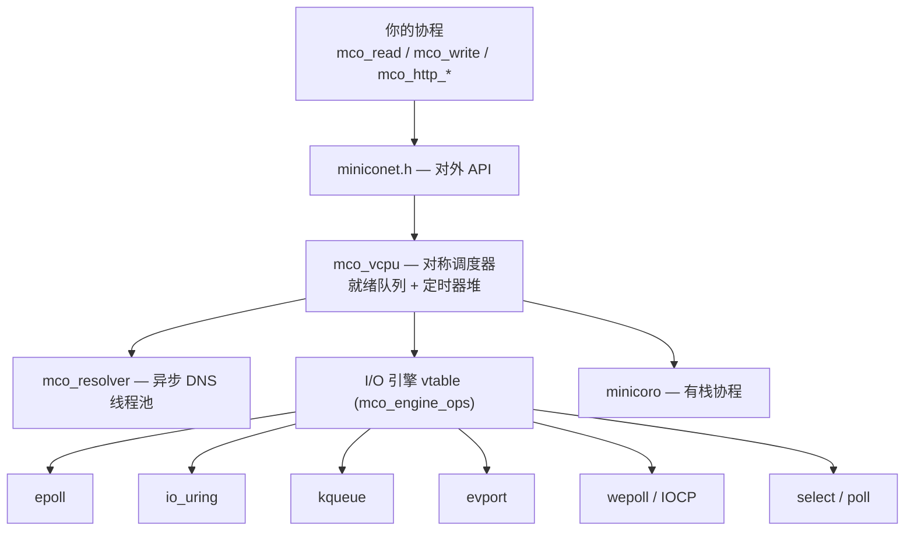

<div align="center">

# miniconet

**纯 C89 实现的协程化跨平台网络库。**

有栈协程（[minicoro](https://github.com/edubart/minicoro)）+ 自研 I/O 引擎（8 个后端）。
写起来是"阻塞式"的网络代码，运行时把它变成事件循环。

[](https://github.com/firear/miniconet/actions/workflows/ci.yml)
[](#平台支持)
[](#平台支持)
[](LICENSE)
[](#参与贡献)

[English](README.md) · [简体中文](README.zh-CN.md)

</div>

---

## 为什么用 miniconet

- **没有回调、没有状态机。** 一个连接一个协程；`mco_read()` 挂起的是*协程*，不是线程——代码从上往下读，和阻塞程序一样直白。
- **TCP / UDP / TLS / Unix socket 一套 API。** 无论明文还是 TLS，都用同样的 `mco_read` / `mco_write`；握手在 `mco_wait_io` 后面完成。
- **异步 DNS，不卡调度器。** 域名解析走后台线程池，协程挂在管道上等，事件循环继续服务其它连接。
- **每请求 CPU 更低、尾延迟更低。** HTTP 服务端 CPU 比成熟的 C++ 运行时低 24–26%，吞吐高 1.3–1.4×。见[性能](#性能)。
- **默认最小化。** HTTP / WebSocket / MQTT / KCP / UPnP / 协议客户端等可选模块，打开才编译。
- **跨平台。** 纯 C89（POSIX 头文件用 gnu89 扩展），8 个 I/O 后端按平台构建期选择、运行期回退。

```c
/* 一个完整的 echo 服务端：接受连接，复制字节直到 EOF。 */
static void echo_conn(void* arg) {
    mco_socket_t* conn = (mco_socket_t*)arg;
    char buf[1024];
    int n;
    while ((n = mco_read(conn, buf, sizeof(buf), -1)) > 0)
        if (mco_write_all(conn, buf, n, -1) != n) break;
    mco_close(conn);
    mco_socket_destroy(conn);
}
```

## 特性一览

| 领域 | 内容 |
|---|---|
| 协程 | `mco_loop_new` / `mco_spawn` / `mco_loop_run`，每循环协程栈池化，`mco_sleep` |
| TCP | listen / accept / connect / read / write / shutdown / close；非阻塞 connect 带失败分类（`MCO_CONNECT_REFUSED` / `DNS` / `TIMEOUT` …） |
| UDP | `mco_udp_bind`、懒创建双栈 `mco_udp_socket`、`sendto` / `recvfrom` |
| TLS | OpenSSL、mbedTLS、GnuTLS、Windows Schannel、Apple TLS——构建期选一个 |
| Unix socket | `mco_tcp_listen_unix` / `mco_tcp_connect_unix`（可选） |
| 定时器 | 跨调用共享的绝对 deadline、socket 级默认超时 |
| DNS | 异步线程池；IP 字面量不走线程 |
| 并发原语 | `mco_oneshot`（一次性信号）、`mco_waitgroup`、可选多线程 `workpool` |
| HTTP | 客户端 + 服务端：keep-alive、chunked、静态文件（含 Range/206）、multipart 落盘、WebSocket 升级 |
| WebSocket | 客户端 + 服务端，自动 PING/PONG、分片重组 |
| 附加 | SOCKS5 代理示例、UPnP IGD 客户端、KCP / MQTT / 阻塞式协议编解码（均需显式开启） |

## 快速开始

```sh
git clone https://github.com/firear/miniconet.git
cd miniconet
cmake -S . -B build -DMINICONET_WITH_OPENSSL=ON
cmake --build build -j
ctest --test-dir build --output-on-failure
```

默认是最小构建（不含 TLS/HTTP）。`ctest` 会跑 `test/` 下的冒烟/回归测试。

### echo 服务端

```c
#include "miniconet.h"
#include <stdio.h>

static void echo_conn(void* arg) {
    mco_socket_t* conn = (mco_socket_t*)arg;
    char buf[1024];
    int n;
    while ((n = mco_read(conn, buf, sizeof(buf), -1)) > 0) {   /* -1 = 永久等待 */
        if (mco_write_all(conn, buf, n, -1) != n) break;
    }
    mco_close(conn);
    mco_socket_destroy(conn);
}

static void accept_loop(void* arg) {
    mco_socket_t* listener = (mco_socket_t*)arg;
    for (;;) {
        mco_socket_t* conn = mco_tcp_accept(listener, -1);
        if (!conn) break;                       /* 监听器已关闭 */
        mco_spawn(mco_vcpu_self(), echo_conn, conn);
    }
}

int main(void) {
    mco_loop_t* loop = mco_loop_new();
    mco_socket_t* listener = mco_tcp_listen("0.0.0.0", 8080);
    if (!listener) return 1;
    mco_spawn(loop, accept_loop, listener);
    mco_loop_run(loop);                          /* 跑到没有协程为止 */
    mco_loop_free(loop);
    return 0;
}
```

### HTTP 客户端 / 服务端

```c
mco_http_response_t* r = mco_http_get("http://example.com/", 5000);
if (r && r->status == 200) printf("%s\n", chars_t_cstr(&r->body));
mco_http_response_free(r);
```

```c
static void hello(mco_http_request_t* req, mco_http_response_t* resp, void* ud) {
    mco_http_resp_text(resp, 200, "hello");
}
mco_http_server_t* srv = mco_http_server_new();
mco_http_server_handle(srv, "GET", "/hello", hello, NULL);
mco_http_server_serve(srv, mco_tcp_listen("0.0.0.0", 8080), loop);
```

更多可运行示例见 [`examples/`](examples)（`tcp_proxy_server.c`、`socks5_server.c`）和 [`test/`](test)（每个特性一个冒烟测试）。

## 架构



- **`core/`** — I/O 引擎接口 + 8 个后端、对称调度器（`mco_vcpu`）、定时器堆（`mco_timer`）、异步 DNS（`mco_resolver`）、并发原语（`mco_oneshot` / `mco_waitgroup` / 可选 `mco_workpool`）。
- **`compat/`** — `hv` 基础设施（内存/socket/时间/线程）+ vendor 的可选模块（TLS 后端、HTTP/MQTT/UPnP/KCP 编解码、crypto 工具）。
- **`miniconet.c/.h`** — 对外 API（TCP / UDP / TLS / Unix socket）。

## 性能

与 [PhotonLibOS](https://github.com/alibaba/PhotonLibOS)（成熟的 C++ 协程运行时）的端到端对比：同一台主机，服务端绑 1 个核、客户端绑 2 个核。表中数值是 miniconet ÷ PhotonLibOS ——延迟/CPU **越低越好**，吞吐**越高越好**。原始数据与方法见 [`PLAN-perf.md`](PLAN-perf.md)，可用 e2e 压测脚本与 `test/bench_*.c` 复现。

| 指标（相对 PhotonLibOS） | epoll | io_uring |
|---|---|---|
| HTTP keep-alive 吞吐（QPS） | **1.31×** | **1.36×** |
| HTTP P50 延迟 | **0.76×** | **0.74×** |
| HTTP P99 延迟 | **0.56×** | **0.72×** |
| HTTP 服务端每请求 CPU | **0.76×** | **0.74×** |
| 大文件（sendfile）吞吐 | **1.66×** | **1.57×** |
| TCP echo 吞吐（8 连接） | 0.99× | **1.06×** |
| TCP echo 服务端每 MB CPU | 1.01× | **0.94×** |
| TCP echo 延迟（1 连接） | ~1.00× | ~1.00× |
| TCP echo 延迟（64 连接） | ~1.01× | ~0.99× |

**赢在哪：** HTTP 吞吐高 31–36%、服务端每请求 CPU 低 24–26%、尾延迟最多降 44%；大文件服务快约 1.6×。

**持平在哪：** TCP echo 双方差距都在几个百分点内——这条路径受内核拷贝限制，运行时能优化的空间本就很小。

**输在哪：** 64 连接小包 ping-pong 场景下，第三个运行时（`chv`）领先约 15%；miniconet 与 PhotonLibOS 在此互在 1% 以内。

> 单机参考值，不是承诺。测试机：Intel i3-7100（2C/4T），Linux。每协程内存约 4.9 KB vs 8.4 KB——见 `PLAN-perf.md`。

## 平台支持

| 后端 | 平台 | 状态 |
|---|---|---|
| `epoll` | Linux | 已测试（默认） |
| `io_uring` | Linux 5.5+ | 已测试（可选，`MINICONET_WITH_IO_URING`） |
| `kqueue` | macOS / \*BSD | 已实现，未在真机验证 |
| `evport` | Solaris / illumos | 已实现，未真机验证 |
| `wepoll` | Windows | 已实现，未真机验证 |
| `IOCP` | Windows | 已实现，仅编译级验证（`MINICONET_WITH_IOCP`） |
| `select` | POSIX + Windows | 已测试（POSIX） |
| `poll` | POSIX | 已测试 |

后端在构建期按平台选择，运行期在内核能力不可用时回退（例如 io_uring 被 seccomp 禁止）。详细状态矩阵见 [`PLAN.md`](PLAN.md)。

## 编译开关

可选能力**默认全部关闭**，产物保持最小。

| 开关 | 默认 | 说明 |
|---|---|---|
| `MINICONET_BUILD_EXAMPLES` | ON | 构建 `test/*` 冒烟测试（注册进 CTest）与 `examples/*` |
| `MINICONET_ENABLE_SANITIZERS` | OFF | 加 ASan + UBSan |
| `MINICONET_WITH_OPENSSL` / `MBEDTLS` / `GNUTLS` | OFF | TLS 后端（最多开一个） |
| `MINICONET_ENABLE_UDS` | OFF | Unix domain socket |
| `MINICONET_WITH_IO_URING` | OFF | Linux io_uring 引擎后端 |
| `MINICONET_WITH_IOCP` | OFF | Windows IOCP 引擎后端 |
| `MINICONET_WITH_WORKPOOL` | OFF | 多线程 `workpool`（N 个 OS 线程各跑一个循环） |
| `MINICONET_WITH_HTTP_PARSER` | OFF | HTTP/WebSocket 解析器 + 协程化 HTTP 客户端/服务端/WS |
| `MINICONET_WITH_MQTT_PROTOCOL` | OFF | MQTT 编解码 |
| `MINICONET_WITH_MINIUPNP` | OFF | UPnP XML 解析器 |
| `MINICONET_WITH_KCP` | OFF | KCP 可靠 UDP 编解码 |
| `MINICONET_WITH_CRYPTO_UTILS` | OFF | MD5 / SHA1 / base64 |
| `MINICONET_WITH_IDNA` | OFF | 国际化域名 |
| `MINICONET_WITH_PROTOCOL_CLIENTS` | OFF | 阻塞式 DNS / FTP / SMTP / ICMP 客户端（不可在协程里用） |
| `MINICONET_WITH_WRAPPER_UTILS` | OFF | `charry` 动态字节数组 + `hmemdup` |
| `MINICONET_WITH_UPNP_CLIENT` | OFF | UPnP IGD 客户端（隐含 HTTP parser + miniupnp） |

`build_and_test.sh` 是薄封装：把环境变量翻译成上面的 `cmake -D`（如 `MINICONET_WITH_OPENSSL=1 ./build_and_test.sh`）。

## 目录结构

```
core/           I/O 引擎接口 + 8 个后端、调度器、定时器堆、异步 DNS、
                oneshot/waitgroup/workpool
compat/         hv 基础设施（hbase/hsocket/htime/hthread/heap/hmutex…）、
                ssl/（TLS 后端）、http/ mqtt/ miniupnp/ kcp/ protocol/ util/（可选）、
                portable/ + wepoll/（Windows）
minicoro/       有栈协程引擎（随仓库附带）
tclog/          异步日志子系统（随仓库附带）
miniconet.c/.h  对外 API：TCP / UDP / TLS / Unix socket
miniconet_http*.c/.h, miniconet_websocket.*, miniconet_upnp.*   可选的协程胶水层
cmake/          可复用 CMake 模块（平台探测、配置生成、TLS 后端选择）
test/           冒烟/回归测试（每个 test/*.c 是一个 CTest 用例）
examples/       可运行示例（TCP 代理、SOCKS5 服务端）
```

## 状态与已知限制

这是一个早期项目，如实说明已验证/未验证的部分：

- **未做生产级加固**，API 在版本间可能变化。
- **部分后端未在真机验证**（kqueue、evport、wepoll、IOCP）——已实现并过了编译检查，但没在 macOS/BSD/Solaris/Windows 真机上跑过。
- **TLS 默认不编译**，且一次只能选一个后端；不支持 DTLS。
- **仅 HTTP/1.1**，不支持 HTTP/2（与"一连接一协程"模型冲突）。
- **协程栈默认 96 KB**，协程里别放大的栈数组，大缓冲走堆。
- **默认一个线程一个循环**；多核请用 `workpool`；socket 不能跨循环共享。
- HTTP 客户端把整个 body 缓冲在内存里，且不处理重定向。

## 参与贡献

欢迎提 issue 和 PR。提交前请先跑：

```sh
cmake -S . -B build -DMINICONET_WITH_HTTP_PARSER=ON -DMINICONET_ENABLE_SANITIZERS=ON
cmake --build build -j && ctest --test-dir build --output-on-failure
```

请沿用现有约定：C89、特性宏一律用 `#if`（不要 `#ifdef`，开关恒为 0/1）、每个特性配一个冒烟测试、注释用英文。

## 许可证

[MIT](LICENSE) © 2025-2026 firear。

## 致谢

miniconet 建立在他人的工作之上。vendor 的代码在每个文件里保留原始许可证头，主要来源：

- [minicoro](https://github.com/edubart/minicoro) —— 有栈协程（MIT / 公有领域）。
- `compat/` 里的 `hv` 基础设施 —— socket/时间/线程/容器工具，源自 [libhv](https://github.com/ithewei/libhv) 与 [libuv](https://github.com/libuv/libuv)（MIT / BSD）。
- [picohttpparser](https://github.com/h2o/picohttpparser)、multipart/websocket 解析器（MIT）。
- [miniupnp](https://github.com/miniupnp/miniupnp) XML 解析器（BSD-3-Clause）。
- [KCP](https://github.com/skywind3000/kcp)（MIT）、MQTT 编解码、MD5/SHA1/base64、IDNA。
- [wepoll](https://github.com/piscisaureus/wepoll) 与 Windows SDK 头文件（Windows 后端）。

设计思路参考：[PhotonLibOS](https://github.com/alibaba/PhotonLibOS)。

采用 copyleft 许可证的第三方代码（一个 GPLv3 的 SOCKS5 头文件、一份 GPLv2 的 Linux 内核 rbtree，二者库本身都未使用）已移除，以便整棵源码树以 MIT 发布。
